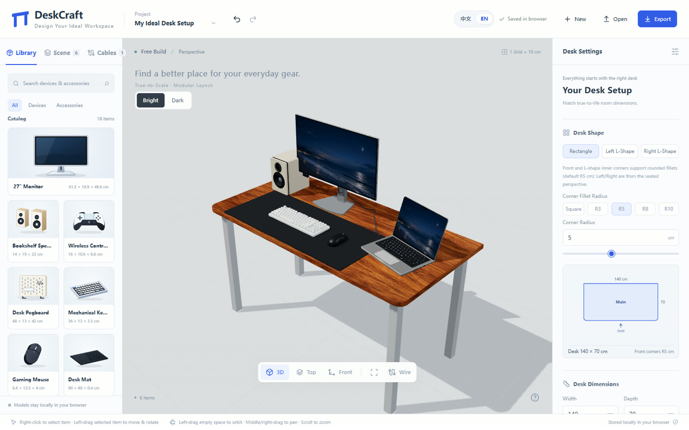

# DeskCraft

#### Video Demo: <URL HERE>

#### Description:

**DeskCraft** (Chinese title: **桌构**) is an interactive, local-first 3D workspace layout and cable-routing studio built for the browser. Before buying new monitors, mounts, speakers, or cables—or before rearranging heavy furniture—users can configure their exact desk dimensions in centimeters, place true-to-scale 3D hardware on the desk or wall, articulate VESA monitor arms and laptop stands, route fixed-length power and signal cables through grommets and cable channels, preview monitor light-bar illumination in bright and dark rooms, and export self-contained project backups.



---

### Core Capabilities

1. **Parametric Desk & Room Geometry**
   - Supports rectangular, left-return L-shaped, and right-return L-shaped desks with configurable width, depth, desktop height, slab thickness, and front/inner-corner fillet radii (`0–12 cm`).
   - Optional integrated full-width riser shelf, rear/left/right privacy partitions (frosted acrylic, felt, or wood), standard cable grommets (`50 / 60 / 80 mm`), under-desk structural crossbar, and a rear wall surface for wall-mounted pegboards and electrical outlets.

2. **18 True-to-Scale De-Branded Procedural 3D Devices & Accessories**
   - Every built-in item is generated procedurally in Three.js at 1:1 physical millimeter dimensions without requiring external 3D asset downloads and without commercial brand logos:
     - **Displays & Lighting**: 24"/27"/32" monitors (curved-back pro stand with pop-out front USB hub or unibody flat-back tilt/height-adjustable stand) and top-mounted monitor light bars with adjustable brightness, correlated color temperature, tilt, beam spread, and soft penumbra falloff.
     - **Computers**: Ultrabooks (`13"–16"` slim and flagship chassis with articulating lid angles), gaming laptops (`14"–17.3"`), mini PCs, and compact desktop workstations.
     - **Input & Audio**: Mechanical/magnetic-switch keyboards (`60% / 65% / 75% / 80% / 98% / 100%` layouts with canvas-rendered legends, RGB underglow, and coiled aviator cables), ergonomic symmetrical gaming mice constructed from analytic convex dome surfaces and 3D planar parting intersections, stitched desk mats (`2–6 mm` thickness with automatic surface stacking), active/passive bookshelf speakers (`3"` and `4"` pairs), and symmetrical/asymmetric wireless controllers.
     - **Mounting, Storage & Power**: Single and dual gas-spring VESA monitor arms (edge C-clamp or grommet mount, upright or overhead-inverted orientation), VESA ventilated laptop trays, dual-hinge and unibody laptop stands, desk/wall pegboards, configurable desktop power strips (`1×3` to `2×4` gangs with USB-A/Type-C ports), and `86`-type wall or flush floor outlets.

3. **Fixed-Length Physical Cable Routing & Modular Power Adapters**
   - Models real-world ports (`HDMI`, `DisplayPort`, `USB4 / Type-C`, `USB-A`, `Magnetic Charge`, `RJ45`, `IEC C13/C14`, `Speaker Wire`, `3.5mm AUX`, `Dual RCA`, `Optical TOSLINK`, and `6.35mm TRS`) at their exact mechanical locations and insertion vectors.
   - Enforces **strict fixed cable lengths**: selecting a `0.8 m`, `1 m`, `1.5 m`, or `2 m` cable never stretches it like a rubber band. If the physical path between two ports exceeds the cable's length budget, connection or shorter-preset switching is rejected with a clear diagnostic; when a cable is longer than the minimum path, its actual physical slack is preserved as smooth gravity-settled service loops so users can plan real cable management.
   - Separates pure charging/data cords (`Dual Type-C` vs. `USB-A to Type-C` and `Magnetic Braided Cable`) from optional plug-in power bricks (`GaN Fast Charger` or `Square Power Adapter`), unlocking AC receptacle pairing only when an adapter accessory is attached.
   - Simulates strain-relief boot stiffness at both connector ends so cables exit ports coaxially before bending smoothly, while avoiding desk slabs, monitor bases, speakers, and under-desk crossbars.

4. **Bilingual Single-Language Interface (`中文 | EN`), Custom glTF Import & Local Persistence**
   - A header toggle switches the entire studio between Chinese (**桌构**) and English (**DeskCraft**) without displaying cluttered dual-language text side by side, persisted to `localStorage` and automatically migrating legacy saved item names.
   - Users can import local `.glb` or self-contained `.gltf` meshes subject to strict static validation (blocking external network URIs, enforcing file-size, buffer, texture-pixel, and `250k`-triangle budgets, and normalizing base-center bounds).
   - Projects auto-save atomically to IndexedDB with 50-step undo/redo history and export/import as standalone `.desksetup.json` archives containing deduplicated Base64 model blobs.

---

### Repository Structure & File Guide

- **Application Entry & Global Styling**
  - `index.html`, `src/main.tsx`: HTML shell and React 19 root bootstrap.
  - `src/App.tsx`: Top-level workspace layout, header toolbar, bilingual `中文 | EN` switch, 3D wiring banner, live drag/collision status pills, keyboard shortcuts, IndexedDB auto-save lifecycle, and `.desksetup.json` / `.glb` file handlers.
  - `src/styles.css`: Complete responsive studio stylesheet covering the three-column desktop workspace, compact drawer layout, custom range sliders, and bilingual toggle controls.

- **Domain Models, Validation & Physical Rules (`src/domain/`)**
  - `project.ts`: Core Zod schemas, dimensional bounds, and cross-item invariants (arm bindings, lamp host validation, cable schemas, and backwards-compatible schema enums).
  - `catalog.ts`: Built-in 18-item catalog definitions, default starter workspace (`27"` monitor + ultrabook pre-wired via dual Type-C), and item factory helpers.
  - `desk.ts`: Parametric desk bounds, L-return wing geometry, grommet coordinates, shelf transforms, and back-wall boundaries.
  - `monitor.ts`, `laptop.ts`, `keyboard.ts`, `mouse.ts`, `mousepad.ts`, `speaker.ts`, `controller.ts`, `pegboard.ts`, `power.ts`, `screenLamp.ts`: Device-specific presets, physical dimensions, official color palettes, and pose kinematics.
  - `ports.ts`: Exact 3D local port positions, insertion normals, socket dimensions, and world-space port transform resolvers across articulated monitor heads, laptop lids, and stands.
  - `cable.ts`: Cable specifications (outer diameters, connector housing lengths, preset lengths, minimum interior bend angles), pure-cord vs. optional adapter resolution, and port-compatibility rules.
  - `cableRouting.ts` & `cablePhysics.ts`: Waypoint path generation through monitor-arm clips, stand slots, and desk grommets; fixed-length reachability validation; tether constraints during item dragging; Verlet/catenary gravity relaxation; and enhanced terminal strain-relief bending resistance.
  - `monitorArm.ts`: Analytical 2-link VESA monitor-arm inverse kinematics, dual-arm socket offsets, workspace reach envelopes, and human-readable limit diagnostics.
  - `collision.ts` & `placement.ts`: Oriented bounding-box obstacle avoidance, desk-boundary out-of-bounds checks, monitor-pose anti-clipping binary search, and solid-box clearance for cables (including under-desk crossbars).

- **Internationalization (`src/i18n/`)**
  - `index.ts`: Lightweight Zustand language store (`zh` / `en`), translation helper `tr()`, obstacle-label translator, and `localizeProjectInPlace()` sanitizer that translates untouched default names and strips legacy brand strings while preserving custom user-edited names.

- **State Management (`src/store/`)**
  - `editorStore.ts`: Central Zustand editor state managing selection, 50-step undo/redo history, gesture coalescing (`beginGesture` / `endGesture`), arm/stand auto-mounting, cable creation/editing, collision notices, and live language synchronization.

- **3D Scene & Procedural CAD Models (`src/scene/`)**
  - `DeskScene.tsx`, `deskCamera.ts`, `orbitPause.ts`: React Three Fiber canvas, WebGL error boundary, camera presets (`3D`, `Top`, `Front`, `Fit`), shadow frustum sizing, and pointer-capture orbit suspension.
  - `Desk.tsx` & `deskGeometry.ts`: Extruded parametric desk slabs with rounded corners, continuous UV wood-grain mapping, legs, crossbar, partitions, grommets, shelf, and rear wall.
  - `SceneItem.tsx`, `ItemRotateGizmo.tsx`, `unitBounds.ts`: Interactive 3D item wrapper (right-click selection, planar/wall drag with anti-clipping and cable-tether clamping) and multi-axis 3D rotation/tilt/pivot/lid gizmos.
  - `MonitorModel.tsx`, `MonitorArmModel.tsx`, `LaptopModel.tsx`, `MacBookModel.tsx`, `MacDesktopModel.tsx`, `LaptopStandModel.tsx`, `LaptopTrayModel.tsx`, `KeyboardModel.tsx`, `keyboardTexture.ts`, `MouseModel.tsx`, `MousepadModel.tsx`, `SpeakerModel.tsx`, `ControllerModel.tsx`, `PegboardModel.tsx`, `PowerModels.tsx`, `BuiltinModels.tsx`, `PortSocket.tsx`: Procedural 1:1 3D hardware meshes and recessed port receptacles.
  - `ScreenLampModel.tsx` & `screenLampLighting.ts`: Dual-spotlight photometric-style beam projection and procedural 256×256 linear falloff cookie textures.
  - `CableSystem.tsx`: Tube-mesh cable renderer, 1:1 connector plugs (including angled plugs, GaN bricks, and square adapters), interactive waypoint handles, and live 3D port-to-port wiring preview.

- **UI Panels (`src/components/`)**
  - `ModelLibrary.tsx` & `ModelThumbnail.tsx`: Left sidebar switching between the searchable categorized Model Library (with 19 custom isometric/orthographic SVG illustrations), Scene item list, and Cable Studio.
  - `CableStudioPanel.tsx`: Signal/audio and power/charging cable configurator, length selector, optional plug-accessory picker, and wired-cable list.
  - `Inspector.tsx`, `DeskInspector.tsx`, `DeviceExtensionsInspector.tsx`, `LampInspector.tsx`, `NumberField.tsx`, `PowerStripDialog.tsx`, `ImportDialog.tsx`: Context-sensitive right-hand property inspectors, power-strip mains cord & wall-outlet configuration modal, and glTF import calibration modal.

- **Asset Pipeline & Persistence (`src/assets/`, `src/persistence/`)**
  - `importModel.ts` & `modelCache.ts`: Binary GLB/glTF header and JSON parser, security/resource-budget validator, bounding-box normalizer, and Three.js disposal cache.
  - `projectRepository.ts`, `projectFile.ts`, `legacyProject.ts`: Transactional IndexedDB storage, Base64 `.desksetup.json` serialization/deserialization, and legacy schema migration.

- **Automated Verification (`src/**/*.test.ts`, `tests/editor.spec.ts`)**
  - 17 Vitest unit test suites (238 tests) covering geometry math, schema invariants, cable physics, collision resolution, and persistence, paired with 49 end-to-end Playwright browser tests.

---

### Key Design Choices & Trade-Offs

1. **Local-First Architecture (`IndexedDB` + `.desksetup.json`) Over a Cloud Backend**
   - Workspace planning involves frequent slider drags and potentially large user-imported `.glb` meshes. Requiring user accounts and uploading multi-megabyte 3D models to a remote server would add latency, hosting costs, and privacy concerns. Storing state in IndexedDB with atomic transaction checks—and bundling deduplicated binary blobs into a portable `.desksetup.json` file—keeps the app instant, offline-capable, and deployable as static files while preventing silent data loss when assets are missing.

2. **Procedural Parametric CAD Geometry Over Static External 3D Meshes**
   - Static `.glb` files stretch unnaturally when a user changes desk dimensions, keyboard layouts, or mousepad thickness, and they obscure exact port coordinates. Building hardware procedurally in Three.js (`MouseModel.tsx`, `MonitorModel.tsx`, `deskGeometry.ts`, etc.) guarantees zero-download startup, crisp dimensional accuracy across presets, clean G1-rounded edges and 3D plane-intersection seams, and mathematical alignment between rendered port sockets and cable-routing endpoints.

3. **Non-Stretching Fixed-Length Cables & Separate Adapter Accessories**
   - Early prototypes routed cables as shortest-path splines that stretched arbitrarily when devices moved. In reality, cable length is one of the tightest constraints in desk setups. I redesigned cables around fixed physical lengths (`cableEffectiveLengths` and `validateCableReachability`): unreachable connections fail immediately, tethered devices stop at their connected cable's length limit, excess length settles under gravity with realistic terminal strain-relief stiffness, and USB-C cords do not magically include wall plugs unless the user attaches a power-adapter accessory.

4. **Reactive Single-Language Toggle (`中文 | EN`) & Schema-Safe De-Branding**
   - Displaying Chinese and English simultaneously cluttered compact inspector controls, while renaming internal `.desksetup.json` enum keys would break previously saved projects. Introducing a dedicated reactive i18n store (`src/i18n/index.ts`) backed by JavaScript property getters on domain presets allows every label, notice, and default item name to switch cleanly between Chinese and English while keeping persisted file schemas 100% backward compatible.

---

### Running & Testing Locally

Requires **Node.js 22.12+** (or 24 LTS) and a modern browser with WebGL enabled:

```bash
npm ci
npm run dev          # Starts Vite dev server at http://localhost:5173
npm run typecheck    # Runs TypeScript project-reference build check
npm test             # Runs all 238 Vitest unit tests
npm run build        # Produces production static bundle in dist/
```

---

### Academic Honesty & AI Assistance Disclosure

In accordance with CS50x's Academic Honesty policy for the Final Project:

- **Author's Work**: The project concept, workspace planning workflow, physical domain specifications (including fixed-length non-stretching cable rules, modular pure-cable vs. optional power-adapter separation, anti-clipping constraints, and de-branded 1:1 hardware standards), UX direction, and iterative visual and functional quality assurance were conceived, directed, and verified by the author.
- **AI Assistance Citation**: AI coding assistants (**Google Gemini** and **Anthropic Claude**) were used during development to assist with procedural Three.js / WebGL geometry math, React and TypeScript component implementation, Vitest/Playwright test scaffolding, and bilingual English/Chinese translation. Source files across `src/` and `tests/` carry explicit header citations reflecting this disclosure.
