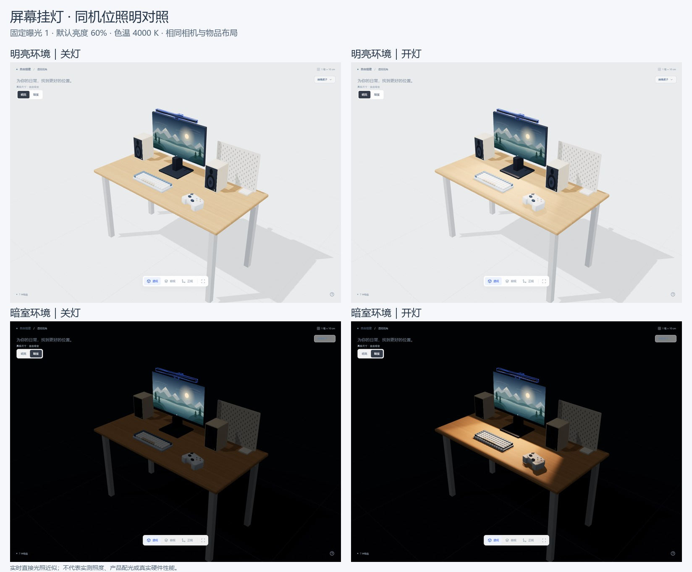

# 桌间 Deskspace

一个本地优先的中文三维桌搭工作台：按尺寸调整桌子，自由摆放常见物品，在购买或搬动实物前预览整体布局。


## 已实现

- 桌型与桌面尺寸：支持矩形、左侧 L 形、右侧 L 形工位桌；人侧前角及 L 形内凹转角支持 0–12 cm 倒圆角（默认 R5 cm）；支持标准 60 mm（可选 50/80 mm）桌面穿孔走线孔；矩形桌还支持工位后／侧隔断挡板与桌体一体等宽平行层架。
- 内置显示器、游戏本（14–17.3"）、MacBook（Air/Pro 13–16"）、Mac mini（经典／M4）、Mac Studio、笔记本支架（斜面／立式）、显示器支架臂（支持单／双支架臂、正装桌缘／倒挂悬吊、1:1 NB FP-2 VESA 笔记本托盘与双长臂理线卡槽）、机械/磁轴键盘（60% / 65% / 75% / 80% / 98% / 100% 配列、带字键帽、RGB 灯效与 1:1 GX16 弹簧航空线）、电竞鼠标（1:1 罗技 GPW 与雷蛇毒蝰系列）、鼠标垫（自定义尺寸、配色与 2–6 mm 合理厚度，支持设备上垫自动贴合）、桌面音响、游戏手柄（1:1 PS5 DualSense 与 Xbox Series 无线手柄）、带底座洞洞板；无需外部模型素材。
- 端口与模拟走线：显示器、笔记本与 Mac 主机支持 DP / HDMI / USB-C / MagSafe 3 / RJ45 网线 / 电源插线模拟，按真机线径与端子造型（含 RJ45 水晶头、DP 锁扣头、MagSafe 3 磁吸头等）还原；支持苹果官方 2 m（含端子）与主流长度预设、自定义线长及“含端子 / 不含端子”口径标注，自动经由支架臂双长臂理线卡槽与桌面 60 mm 走线孔垂落或点对点连接。
- 显示器支持两套 1:1 模具：**戴尔 UltraSharp**（四边超窄黑边、铂金银背壳、理线镂空立柱与 < 27 寸 / 27–32 寸 / > 32 寸三段式底座，内置 24 / 27 / 32 寸 16:9 预设并可调宽度高度）与 **Apple Studio Display 27" 5K**（`62.3 × 36.2 × 3.1 cm` 一体铝壳黑边玻璃前板与居中镜头、背面 Apple 徽标与雷雳/USB-C 端口，可选官方可调倾角 `16.8 cm` 或 `10.5 cm` 升降支架）。
- 屏幕挂灯：安装在内置显示器顶边，支持亮度、色温、倾角、水平／垂直光束角和柔边调节；随屏幕拖动、升降、俯仰及横竖屏变化。
- 明亮／暗室照明环境切换，固定曝光比较开关灯效果；环境与挂灯参数可保存和撤销。
- 选择、桌面平面拖动、位置输入、竖轴旋转、尺寸编辑、复制、删除。
- 透视、俯视、正视、适配桌面；桌高变化时物品随之移动。
- 50 步撤销/重做；旋转后的包围盒越界提示。
- 本地 GLB / 自包含 glTF 导入，底部中心归一化、预览、等比尺寸校正。
- IndexedDB 自动保存；下载/重新打开包含模型资源的单文件工程。
- 中文错误提示、文件与复杂度预算、窄屏抽屉布局。

**本版本没有 AI 图片建模、账户、云同步、真实物理碰撞、堆叠或挂墙系统。** 洞洞板是带底座的桌面物件；内置模型为无品牌近似外观。首版以电脑鼠标键盘为主，窄屏不代表完整手机触控编辑体验。

## 启动

建议 Node.js 22.12+ 或 24 LTS，现代浏览器并开启 WebGL / 硬件加速。

### Windows 双击启动

双击项目根目录的 **[启动桌间.bat](启动桌间.bat)**，服务就绪后会自动打开浏览器。已有本项目服务时直接打开现有页面；固定使用 5173 端口，避免端口变化导致读不到原有浏览器布局。

首次缺少依赖时会自动安装，需要联网。使用期间保留启动窗口，关闭窗口即停止本次服务。启动文件应留在项目目录内；需要桌面入口时请创建快捷方式，不要只把启动文件移走。

### 命令行启动

安装锁定依赖：

```bash
npm ci
```

启动开发服务：

```bash
npm run dev
```

打开 http://localhost:5173 。开发服务监听所有网卡，请仅在可信网络中使用。

构建静态站点：

```bash
npm run build
```

输出在 dist/，可部署至静态托管平台，无业务后端。Three.js 渲染引擎体积较大，首次打开需要加载这些依赖。

## 操作和单位

1. 点击左侧模型卡片添加物品，“场景”列表可选中被遮挡的物品。
2. 左键拖动物品；空白处左键旋转视角、中键或右键平移、滚轮缩放。
3. 右侧输入宽/深/高、左右/前后位置、角度。回车或失焦提交数值；Esc 取消当前数值或拖动。
4. 点击“编辑桌子”或空白处回到桌子设置。桌高指上表面距地面距离，不是桌腿长度。
5. Ctrl/⌘ + Z 撤销，Ctrl/⌘ + Shift + Z 重做；Ctrl/⌘ + D 复制，Delete 删除。输入框内保留文字快捷键。
6. 用“导出工程”备份，在另一个浏览器中用“打开工程”恢复布局和模型。

界面显示厘米，内部使用米。X 左右、Y 向上、Z 前后，正 Z 朝默认观察者。主桌中心始终是坐标原点：矩形桌主桌范围 X=[−W/2, W/2]、Z=[−D/2, D/2]；L 形桌的左／右侧翼以坐在桌前、面向主桌时为准（分别在 −X 或 +X 侧），自 Z=+D/2 起向前延伸。**“向前延伸”不包含主桌深度**（总深度 = 主桌深度 + 向前延伸），侧翼宽度限制在 30–min(120, 主桌宽度−30) cm 以保留内凹缺口；缩小主桌宽度时侧翼宽度会同步缩小，切回矩形后再启用 L 形会恢复默认侧翼尺寸，可用撤销还原。

物品位置相对主桌中心，底部贴桌面；切换桌型或缩小尺寸不会偷偷移动物品。矩形与 L 形均按真实桌面轮廓判断越界（包括跨越内凹缺口的物品），但边界检查不是物理模拟、碰撞阻挡或承重／人体工学认证。改变桌板厚度不改变上表面高度，物品可以重叠。

## 挂灯与照明预览

先添加内置显示器，再在模型库添加“屏幕挂灯”。优先安装到当前选中的空闲显示器，否则使用第一台空闲显示器；每屏一盏，全场景最多两盏。属性面板可换绑空闲显示器，灯条长 30–60 cm，夹具尺寸固定。复制显示器会连同挂灯复制，删除显示器会连同挂灯删除；这些操作均可一步撤销。挂灯不独立拖动或参与桌面越界检查。

“明亮／暗室”只切换三维场景的环境光，不改变编辑器主题。两种环境曝光相同；挂灯通过真实聚光采样、柔边矩形配光、距离衰减和阴影影响受光材质，而非桌面亮斑贴图。光束角为完整角度；向前倾角相对灯具的局部向下方向，随屏幕姿态变化。“显示光路示意”只是临时参考线，不计算遮挡，也不代表空气中可见的光柱。

**这是布局照明的实时近似，不是经过实测校准的光度仿真。** 每灯两个采样，阴影可能有轻微分层；“边缘柔化”调节光区边缘，不等于连续面积光源的真实半影。亮度为相对值，不输出 lux、UGR、产品流明或护眼结论；不模拟全局光照、屏幕向外照明或真实反射。屏幕壁纸保持自亮，导入的 unlit 材质不受灯光影响。纹理采样能力不足的设备会提示挂灯预览不可用，但保留工程数据。

旧工程缺少环境字段时按明亮显示；历史装饰灯 `lightbar` 会被清理，新挂灯 `screenLamp` 正常保存。不保证旧版应用可打开包含新组件的工程。



## 模型格式和预算

支持 glTF 2.0 静态三角网格：

- GLB 的 buffer、PNG/JPEG 纹理必须内嵌。
- glTF 的 buffer、图片必须为内嵌 Base64 data URI。
- 不接受网络 URL、独立 .bin 或纹理侧文件，请先导出为资源内嵌的 GLB。
- 扩展仅支持 KHR_materials_unlit。不支持 Draco、Meshopt、KTX2、骨骼、动画、形变、sparse accessor、线/点、APNG 或零厚度网格。
- 单文件最多 15 MiB；工程原始模型资源合计 40 MiB。
- 单模型最多 25 万三角形；场景实例按预算限制为约 50 万三角形。
- 纹理单边最多 4096、最多 16 张、解码总像素最多 16M；另有缓冲区与层级预算。文件字节数不等于运行内存。

导入默认建议最长边 30 cm。**请按实物测量值校正，不能假定文件具有正确物理尺寸。** 导入模型保持等比缩放，内置物品可分别调整各轴。

## 保存、备份与隐私

自动保存到当前站点来源的浏览器 IndexedDB。编辑提交约 500 ms 后写入，仅在事务成功后显示“已保存到此浏览器”；慢设备可能需要更久，请等待该提示后刷新。恢复失败不会自动用默认工程覆盖原有记录。

**本地保存不是云备份。** 换设备、换浏览器、换域名/端口、清理站点数据，都可能无法读取原工程。请下载 .desksetup.json 工程到自己的磁盘。文件包含当前场景所需的去重模型字节，不依赖临时链接；Base64 约增加三分之一体积，工程文件最多 58 MiB。

资源缺失时保留占位盒和物品记录，并暂停自动保存，请用完整备份恢复。缺少被引用模型时无法导出完整备份，不会生成假装成功的空资源工程。新建或打开其他工程前会请求替换确认。

没有账户、遥测、外部字体或 AI 服务；用户模型不上传。外部资源地址在解析前和加载器阶段均被阻止。预算检查不是通用文件安全沙箱，仍应谨慎处理不可信大文件。

## 开发与验证

React 19 + TypeScript + Vite，Three.js / React Three Fiber / Drei，Zustand、Zod、idb。

```bash
npm run typecheck
```

```bash
npm test
```

单元测试覆盖领域校验、旋转越界、编辑历史、模型预检与归一化、缓存释放、IndexedDB 原子回滚、工程 Base64 和资源校验。存储测试使用 fake-indexeddb。

浏览器测试需**先保持开发服务在运行**，然后安装 Chromium：

```bash
npx playwright install chromium
```

```bash
npm run test:e2e
```

Playwright 使用独立上下文，不改动日常浏览器的布局。软件 WebGL 配置用于无 GPU 环境验收，不用于声称真实硬件性能。用例覆盖拖拽与取消、编辑历史、模型导入、刷新恢复、跨上下文备份、外部请求阻断和窄屏布局。

```bash
npm run format:check
```

目录：

- src/domain：数据与尺寸规则。
- src/store：编辑命令、历史和运行时资源引用。
- src/scene：桌子、内置模型、相机与拖拽。
- src/components：中文编辑界面和导入确认。
- src/assets：模型校验、加载、归一化与缓存。
- src/persistence：本地事务、工程文件交换。
- tests：真实浏览器验收。

## AI 扩展边界

图片转三维留到下一阶段。现有资产入口可复用，但真实生成服务需要明确供应商、费用、第三方图片传输、服务端密钥管理和异步任务，并继续要求用户确认实物尺寸。本版本不提供模拟 AI 生成按钮。
